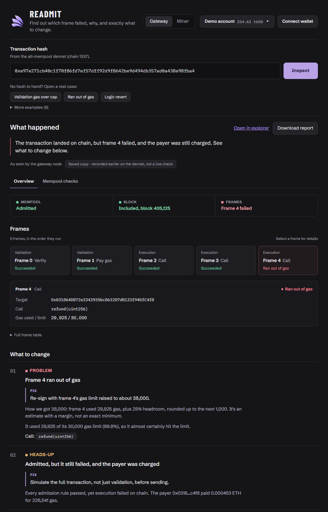
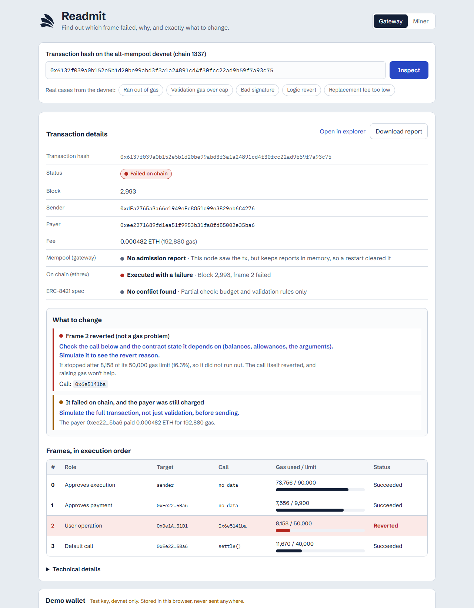

# Readmit

Find out which frame of an EIP-8141 frame transaction failed, why, and what to change. Then send your own transaction with a dry run first, and fix it in one click.

**Live:** https://readmit-kohl.vercel.app · **SDK:** [readmit-sdk](https://github.com/manjeetsharma0796/readmit-sdk) · runs against the EF alt-mempool devnet (chain 1337).

Paste a transaction hash from the alt-mempool devnet (chain 1337). Readmit shows:

- **Three verdicts:**
  - the live mempool sidecar (gateway or miner),
  - the chain itself (the ethrex receipt),
  - a partial ERC-8421 check, which covers the validation-gas budget and validation reverts.
- **What happened**, in plain language, with the failing frame and a concrete fix. Example: "frame 4 used 29,925 of 30,000 gas, so raise it to about 38,000".
- **Frames in execution order.** Each frame shows its role, its target, the decoded call and its gas used against its limit.
- **Every admission rule the sidecar ran**, plus a downloadable JSON report.
- **The latest admissions from the node**, with live stats: how many were rejected, from how many senders, and the top rule names. Click any of them to inspect it.
- **12 saved real cases** from the devnet, grouped by where they failed (rejected by the mempool, failed on chain, worked).
- **Send with a dry run first.** A demo wallet holding tUSD and 0 ETH sends tUSD. Gas is paid in tUSD through our staked paymaster. `ethrex_simulateFrameTransaction` runs before anything is broadcast, and the send stops if it finds a problem.
- **Fix & send.** If a frame would run out of gas, or did on chain, one button applies the new limit, re-quotes the tUSD fee, runs the dry run again and sends. The old hash ❌ shows next to the new one ✅.

It runs entirely in the browser. It talks directly to the sidecar and ethrex RPCs, which allow CORS from any origin, and to the sourcify signature database for decoding 4-byte selectors. There is no backend and no analytics. The only key is an optional devnet demo key, imported into your browser for the send flow.

## Screenshots

| Out of gas: the exact fix | Logic revert: raising gas won't help |
|---|---|
|  |  |

Both are real devnet transactions, shown from saved copies. `0x6137…` is on the current chain (block 2,993). `0xe97e…` is from an earlier run of the devnet (block 405,125) that has since been reset, so its explorer link no longer opens.

## Run

```bash
npm install
npm run dev     # http://localhost:5173
npm run check   # self-check: 21 diagnosis checks built on the 15 recorded devnet cases, plus build/sign/decode and send-status checks
npm run build   # static export to out/
```

Needs Node 23.6 or later (24 LTS recommended), because `npm run check` runs TypeScript directly. Diagnosis needs no key. Sending needs a devnet key that holds tUSD: the paymaster requires the sender to already hold the fee, so a fresh key can't start on its own. We don't publish our demo key, because a public key would let anyone race its nonce during the live demo. The video and the Proof table show the send flow end to end.

Share a result with `?tx=<hash>&node=gateway|miner`.

## Files

| File | What |
|---|---|
| `src/diagnose.ts` | Pure diagnosis engine: admission report + receipt (or a dry run) in, findings with fixes + 3 verdicts out. No network. |
| `src/rpc.ts` | Endpoints (editable), send, dry run, status tracking, the sidecar's `skandha_explorer_*` API, receipts, selector lookup |
| `src/engine/frames.ts` | Build, quote, patch, sign, decode and replay frame transactions (viem + `@forshtat/hegota-support`) |
| `src/App.tsx`, `src/ui/` | The app: diagnosis page, wallet, Send, Fix & send, faucet, endpoints panel |
| `src/samples/*.json` | 15 recorded devnet cases: 12 transactions (shown in the app) and 3 dry runs. They work offline and back `npm run check`. |
| `contracts/` | `V4PricedPaymaster` and its deploy scripts (Foundry) |
| `docs/` | Pitch, research notes, judge Q&A and submission text |

## SDK: [`readmit-sdk`](https://github.com/manjeetsharma0796/readmit-sdk)

Readmit's engine is also a standalone TypeScript package for your own code, **[@readmit/sdk](https://github.com/manjeetsharma0796/readmit-sdk)**. It covers:
- explaining any tx by hash;
- the admission simulator (dry run);
- machine-readable fixes and the dry-run → fix → send loop;
- `waitForInclusion`;
- mempool monitoring stats;
- the fragility check;
- a generic frame builder;
- pluggable signers (key, viem account, or custom schemes such as post-quantum);
- viem `client.extend(frameActions(...))`;
- typed errors.

```bash
npm install github:manjeetsharma0796/readmit-sdk viem
```

```ts
import { createReadmit, ALT_MEMPOOL_DEVNET } from '@readmit/sdk'

const r = createReadmit(ALT_MEMPOOL_DEVNET)
const dx = await r.explain('0x3fd93ca4a082d636d08fc27a8afd65b6449dda7aff6609736e8f080064724b9c')
dx.findings[0] // { tone, frame?, title, why, fix?, patch? }

const { hash } = await r.sendDraft(draft, signer) // dry run, apply the fix if needed, then send
await r.waitForInclusion(hash)                    // receipt, or TxNotIncluded with the diagnosis
```

See the [SDK README](https://github.com/manjeetsharma0796/readmit-sdk#readme) for the full API, configuration, errors and the ERC-20 paymaster recipe. Open SDK work (CI, npm publish, moving this app onto the package, stable finding codes, and more) is in its [TASKS.md](https://github.com/manjeetsharma0796/readmit-sdk/blob/main/TASKS.md).

The SDK signs the same bytes as this app's engine; its test suite checks this against a golden hash. The app still calls its own modules directly (`src/diagnose.ts`, `src/rpc.ts`, `src/engine/frames.ts`). `src/diagnose.ts` is shared: fix diagnosis bugs in both repos until the app depends on the package.

## Contracts (`contracts/`)

Foundry project. `V4PricedPaymaster` lets a user pay gas in tUSD: its VERIFY frame reads the Uniswap v4 pool price (`StateLibrary.getSlot0`), and the next SENDER frame must pay at least `quote()` tUSD. It is deployed and staked on chain 1337. See [Uniswap integration](#uniswap-integration).

```bash
npm install                            # at the repo root: also provides @forshtat/hegota-support (EIP-8141 opcodes for Solidity)
cd contracts
forge install --no-git uniswap/v4-core@main foundry-rs/forge-std   # must be @main; the v4.0.0 tag does not compile with this kit
forge test --fork-url https://altmempool.forshtat.com
```

| File | What |
|---|---|
| `src/V4PricedPaymaster.sol` | The paymaster: v4-priced gas in tUSD, plus a stake forwarder for the alt-mempool staking registry |
| `script/SetupPool.s.sol` | Deploys tUSD, the ETH/tUSD v4 pool, liquidity and the paymaster (`SetupPool`), stakes it (`StakePaymaster`), and moves the price (`MovePrice`) |
| `test/Quote.t.sol` | Fork test against the live devnet |
| `test/Withdraw.t.sol` | Owner-only `withdraw` |

Deploy with `--skip-simulation -g 105`. Forge underestimates this devnet's state gas, so the gas limits come from the node's own estimate, and the largest v4 test router sits near the 16.7M per-transaction cap.

## Proof (live on chain 1337)

Every row is a real transaction on the EF alt-mempool devnet. Each included one was checked against the ethrex receipt (the dropped one has no receipt, by design); the payer is our paymaster, and the sender holds 0 ETH. Links open the devnet explorer; paste any hash into Readmit for the diagnosis.

| What it shows | Tx | Result |
|---|---|---|
| Golden tx: paid in tUSD through the staked v4-priced paymaster | [`0x3fd93ca4…4b9c`](https://explorer.altmempool.wtf/tx/0x3fd93ca4a082d636d08fc27a8afd65b6449dda7aff6609736e8f080064724b9c?node=https%3A%2F%2Faltmempool.forshtat.com%2Frpc) | Admitted, 24 of 24 checks; block 6,065 |
| Send screen, end to end (dev build) | [`0x5eca1cab…a1ff`](https://explorer.altmempool.wtf/tx/0x5eca1caba53c6229bd56ec4a8e1953a08b6550474e0856eac21b604a22e2a1ff?node=https%3A%2F%2Faltmempool.forshtat.com%2Frpc) | Block 7,236; fee 2.969998 tUSD |
| **Fix & send:** the dry run caught "frame 3 would run out of gas, 16,000 of 16,000"; the fix used 20,000 | [`0xf09e55cf…0d4e`](https://explorer.altmempool.wtf/tx/0xf09e55cfe3a53b2bf7161aba59bc912b347954e557519dd980e349ad44830d4e?node=https%3A%2F%2Faltmempool.forshtat.com%2Frpc) | Block 7,261; frame 3 used 18,461 of 20,000 |
| Send screen from the **static build** (`out/`) in a clean browser | [`0xdad06ce5…77ed`](https://explorer.altmempool.wtf/tx/0xdad06ce56c987774f8ba648f573c01e3c9b452e2c772e65b709ad9717acc77ed?node=https%3A%2F%2Faltmempool.forshtat.com%2Frpc) | Block 8,269; fee 5.939998 tUSD. The network gas price had risen, so the quote rose with it |
| Fix & send from the static build: admitted, then **dropped by the devnet's miner** ("relayed 4 times without being included in a block") | [`0x6fa1abb2…984f`](https://explorer.altmempool.wtf/tx/0x6fa1abb2ebae7afc0999052b54218b950a934c8b8919bba2c97923da68d2984f?node=https%3A%2F%2Faltmempool.forshtat.com%2Frpc) | Not included. Readmit showed "The mempool dropped it before inclusion, press Send again". This is devnet relay behaviour, not a validation failure: 0 checks failed |
| **Faucet** (Demo account menu, top right): a frame tx that mints 100 tUSD to the demo account, with its gas paid in tUSD | [`0x352a2613…a911`](https://explorer.altmempool.wtf/tx/0x352a261328dab1e5138adb381efb2359863639d7ca94dc3c698f98e35e83a911?node=https%3A%2F%2Faltmempool.forshtat.com%2Frpc) | Block 9,181; balance 77.444008 to 174.47401 tUSD (+100 minus 2.969998 fee), still 0 ETH |

Diagnosis examples (saved copies, these open in the app): `0x6137f039…a93c75` (logic revert, block 2,993) and `0xe97e271c…fba4` (out of gas, from an earlier devnet run that has since been reset).

## Uniswap integration

**Gas is paid in tUSD, priced by a Uniswap v4 pool, while the frame transaction is being validated.** Our paymaster reads the ETH/tUSD pool's `slot0` inside its VERIFY frame. It charges that price plus 10% in tUSD, and only then approves paying the ETH gas. The public mempool forbids this kind of read during validation ("StorageReadNonSender"). The ERC-8421 alternative mempool admits it because the paymaster is staked.

### Where the Uniswap code is
| What | Code |
|---|---|
| Price read: `StateLibrary.getSlot0` on the v4 `PoolManager`, converted from `sqrtPriceX96` with `FullMath` | [`V4PricedPaymaster.sol#L45-L49` `quote()`](https://github.com/manjeetsharma0796/readmit/blob/8cdaa12352566268fcf26f779fab1f7b83611fdc/contracts/src/V4PricedPaymaster.sol#L45-L49) |
| VERIFY frame: next frame must pay at least `quote(MAX_COST)` tUSD, otherwise `"underpaid"` | [`V4PricedPaymaster.sol#L53-L66` `fallback()`](https://github.com/manjeetsharma0796/readmit/blob/8cdaa12352566268fcf26f779fab1f7b83611fdc/contracts/src/V4PricedPaymaster.sol#L53-L66) |
| Pool creation: `PoolManager.initialize` (native ETH / tUSD, 0.3%, tick spacing 60, 1 ETH = 3000 tUSD) | [`SetupPool.s.sol#L25-L27`](https://github.com/manjeetsharma0796/readmit/blob/8cdaa12352566268fcf26f779fab1f7b83611fdc/contracts/script/SetupPool.s.sol#L25-L27) |
| Liquidity: full-range `modifyLiquidity` | [`SetupPool.s.sol#L32`](https://github.com/manjeetsharma0796/readmit/blob/8cdaa12352566268fcf26f779fab1f7b83611fdc/contracts/script/SetupPool.s.sol#L32) |
| Price move for the demo: v4 `swap` through `PoolSwapTest` | [`SetupPool.s.sol#L67`](https://github.com/manjeetsharma0796/readmit/blob/8cdaa12352566268fcf26f779fab1f7b83611fdc/contracts/script/SetupPool.s.sol#L67) |
| App: reads the paymaster's v4-based `quote()` to set the fee before signing | [`frames.ts#L47` `quote()`](https://github.com/manjeetsharma0796/readmit/blob/8cdaa12352566268fcf26f779fab1f7b83611fdc/src/engine/frames.ts#L47), [`#L64` `buildSendTx`](https://github.com/manjeetsharma0796/readmit/blob/8cdaa12352566268fcf26f779fab1f7b83611fdc/src/engine/frames.ts#L64) |
| App: the dry run catches `"underpaid"` before anything is broadcast; pressing Send again re-reads `quote()`, and every gas Fix & send re-quotes too | [`frames.ts#L77` `requote()`](https://github.com/manjeetsharma0796/readmit/blob/8cdaa12352566268fcf26f779fab1f7b83611fdc/src/engine/frames.ts#L77), [`diagnose.ts#L58`](https://github.com/manjeetsharma0796/readmit/blob/8cdaa12352566268fcf26f779fab1f7b83611fdc/src/diagnose.ts#L58) |

### Deployed on the EF alt-mempool devnet (chain 1337)
All of these are also in [`contracts/deployments/1337.json`](contracts/deployments/1337.json). The Uniswap v4 `PoolManager` is the devnet's predeploy, `0x6bF9Aa9c04fd001385742d61f6818C3236429848`.

| Contract | Address | Created in |
|---|---|---|
| tUSD (v4-core `TestERC20`, 6-decimal amounts) | `0xFa85eaee2c9abF09Ec7c305692979C0Ab91D0024` | `0x12bae3d19db5805d94aa61db4b98376fc45ba17a699d92e1ce44f4863d473a36` |
| ETH/tUSD pool | pool id `0x34922fed10996ce5dd957a27451ba63cc0cefb6e33f83cad6b9bf7aa176e4975` | `initialize`: `0x82c3ce8a1eeb46ba04a83fd2698dc5cd5f3ce068cc8b7508df0f0868e42ffdba` (block 5,999), `modifyLiquidity`: `0xe5f01d41625d798c45098f3e7cd9c880b472d3652c63d6959fa73775c8bb33d0` (block 6,004) |
| `V4PricedPaymaster` | `0xc9ca898B92fA53635959021239E190Cf22c1F1d9` | `0x8a3cb27a3b61e33e8afd946127b0caa232da87b05fd4c2755e25d860b58f411e` |
| Stake, 0.012 ETH with an 86,400 s delay, in the alt-mempool staking registry `0xD51c04d7A0B01124E84DE152F4e56d9eeCB22D2F` | — | `0x84c42869f245cb6c8c68bc568bca2908cf399c6eb9807dff4c68443ccc6a22a9` |

### A transaction paid in tUSD through it
[`0x3fd93ca4…4b9c`](https://explorer.altmempool.wtf/tx/0x3fd93ca4a082d636d08fc27a8afd65b6449dda7aff6609736e8f080064724b9c?node=https%3A%2F%2Faltmempool.forshtat.com%2Frpc)
- A wallet holding **0 ETH** sent 1 tUSD, and paid **2.969998 tUSD** to the paymaster: its quote, at the pool price plus 10%, for the transaction's maximum gas cost.
- It was admitted by the alt mempool with 24 of 24 checks passing, and included in block 6,065 with every frame successful. The payer is the paymaster.
- A dry run of the same tx says the public mempool would refuse it: `StorageReadNonSender`, which is the v4 `slot0` read.

Developer feedback for Uniswap is in [`FEEDBACK.md`](FEEDBACK.md).

## CROPS

- **C, censorship resistance (lead).** If one mempool refuses your transaction, Readmit shows the exact rule that rejected it and what to change, so you can get it admitted through another node (gateway or miner). Readmit is a static site with no server of ours in the path, and you can point it at your own ethrex RPC and sidecars ("Endpoints" in the footer). What we control: the domain (`readmit-kohl.vercel.app`; if it goes away, `npm run build` and serve `out/` from any static host) and the staked `V4PricedPaymaster`, whose ETH deposit pays for sends. Its owner can withdraw that deposit, which would stop Send and Fix & send; diagnosis keeps working, and anyone can deploy their own paymaster from `contracts/`.
- **O, open source.** MIT licensed. Everything in the demo builds from this repo.
- **P, privacy.** No trackers, analytics or cookies, and fonts are self-hosted. What each third party learns: the static host (Vercel) sees your IP and page loads; the ethrex RPC and the sidecars see your IP and the hashes you look up or send; Sourcify sees which 4-byte selectors you decode.
- **S, security.** The demo key is stored unencrypted in this browser's localStorage (`readmit.demoKey`) and is never sent anywhere; "Forget key" deletes it. Any script on this origin could read it, which is why it is a devnet-only test key. Every send is dry-run with `ethrex_simulateFrameTransaction` before anything is broadcast. Trust assumption: the ethrex RPC you use supplies the nonce, the gas price, the paymaster's tUSD quote and the dry-run verdict, so a malicious RPC could make you sign a higher fee. The chain id (1337) and the token and paymaster addresses are built into the app, and a share link can't change endpoints.

**Trade-offs.**
- Calling RPCs straight from the browser means those RPCs see your IP address.
- The selector lookup tells Sourcify which selectors you decoded.
- Keys held in the browser are fine on a test network and not acceptable for real funds.
- The ERC-8421 check is partial: it covers the validation-gas budget and validation reverts, not the full rule set.
- The paymaster charges its quote for the transaction's **maximum** cost (every gas limit × the max fee, with a 2 gwei floor) and doesn't refund unused gas yet. The golden tx used 216,746 gas (about 0.72 tUSD at the pool price) and paid 2.97 tUSD.
- `npm audit --omit=dev` reports advisories, all transitive through wagmi 2 and RainbowKit (the WalletConnect, MetaMask and Coinbase SDKs). The live build uses only the injected-wallet connector, so those SDKs are bundled but never loaded: on page load the browser contacts only the site and the two devnet hosts (checked Sat 7 Nov 07:15 IST).

## Not built yet

- Fix & send for anything other than a gas limit (the engine also produces a re-quote patch; the UI applies gas fixes only).
- Stake helper.
- The full ERC-8421 rule set.
- Fuzzing and minimisation.

## How we built it: history, AI use and what we reused

**History.** Hacking began on Thu 5 Nov.
- Until Fri 6 Nov 21:00 IST we worked in a local folder on a prototype called FrameLab. That work covered devnet probing, capturing real failures and a paymaster spike.
- The earliest saved case, `0xe97e…fba4`, was mined on Thu 5 Nov at 23:14 IST (`blockTimestamp` in `src/samples/reverted-out-of-gas.json`).
- We created this repo at 21:04 on Fri. Its first five commits (`c623751`…`635bb16`, about 1,200 lines of code without the lockfile and samples) import that prototype.
- Every change after that is a small commit tied to a ticket in [`TASKS.md`](TASKS.md).
- One rewrite: commit [`c20f83e`](https://github.com/manjeetsharma0796/readmit/commit/c20f83e221728f6db5dc8785fcc27b9757cb30b8) ("T09: claim", Fri 22:15) carried a Claude co-author line. It was amended to `33feca6` and force-pushed. The original is still on GitHub.

**AI use.** We built Readmit with AI coding agents, and they wrote most of the code and docs in this repo:
- Of the 76 tickets in `TASKS.md`, Claude Code worked 66, Codex worked 1 and teammates did 4 by hand. 5 were never started.
- Each ticket's `agent:` line names the agent and the teammate it worked for. Its `do:` line says who asked for the change and why, and its `log:` line holds the evidence.

**What the team did.**
- We set the spec and the priorities ([`docs/PRD.md`](docs/PRD.md) and the ticket board), the rules every agent follows ([`AGENTS.md`](AGENTS.md)), and the design direction.
- A teammate approved and ran every deploy, stake and transaction ([`AGENTS.md`](AGENTS.md) §5), and we checked each result on the devnet.
- Commits are made under each teammate's own git identity, and a hook keeps AI co-author lines out of commit messages ([`AGENTS.md`](AGENTS.md) §4). This section and `TASKS.md` are the record of AI use instead.
- The spec and prompt artifacts are [`docs/PRD.md`](docs/PRD.md), [`AGENTS.md`](AGENTS.md), [`TASKS.md`](TASKS.md) and [`docs/RESEARCH.md`](docs/RESEARCH.md). The PRD's decision record and hour plan were folded into the gates in `TASKS.md`.

**Reused, not ours:**
- [`@forshtat/hegota-support`](https://www.npmjs.com/package/@forshtat/hegota-support): EIP-8141 opcodes for Solidity, and the frame-transaction encoding and RPC types.
- Uniswap [v4-core](https://github.com/Uniswap/v4-core): `StateLibrary`, `FullMath`, `TestERC20`, and the `PoolSwapTest` and `PoolModifyLiquidityTest` routers.
- forge-std, viem, Next.js, React, wagmi and RainbowKit.
- The EF alt-mempool devnet: ethrex, the Skandha-based sidecar and its explorer API.
- The Sourcify signature database for 4-byte decoding.

Everything else in `src/` and `contracts/` was written during the hackathon.

## Licence

MIT
