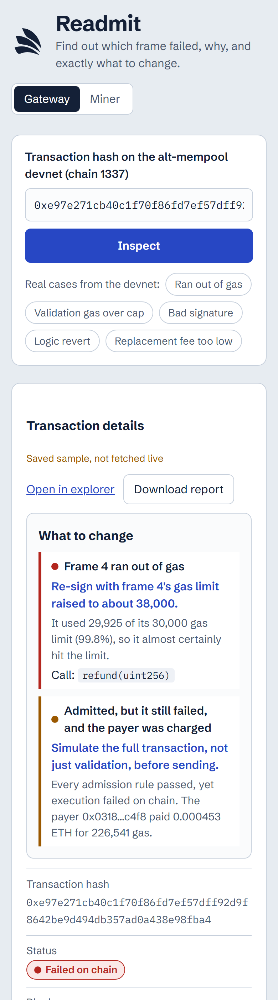

# Readmit

Find out why an EIP-8141 frame transaction was rejected, and what to change.

Paste a transaction hash from the alt-mempool devnet (chain 1337). Readmit shows:

- **Three verdicts side by side:**
  - the live mempool sidecar (gateway or miner),
  - the chain itself (the ethrex receipt),
  - a partial ERC-8421 check, which covers the validation-gas budget and validation reverts.
- **What happened**, in plain language, with the failing frame and a concrete fix. Example: "frame 4 used 29,925 of 30,000 gas, so raise it to about 38,000".
- **Frames in execution order.** Each frame shows its role, its target, the decoded call and a gas-used vs gas-limit bar.
- **Every admission rule the sidecar ran**, plus a downloadable JSON report.
- **The latest admissions from the node.** Click any of them to inspect it.

It runs entirely in the browser. It talks directly to the sidecar and ethrex RPCs, which allow CORS from any origin, and to the sourcify signature database for decoding 4-byte selectors. There is no backend, and it uses no keys and no analytics.

## Screenshots

| Out of gas: the exact fix | Logic revert: raising gas won't help | On a phone |
|---|---|---|
|  |  |  |

Both are real devnet transactions, shown from saved copies because the node keeps history in memory.

## Run

```bash
npm install
npm run dev          # http://localhost:5173
node src/diagnose.check.ts   # self-check on 4 real devnet cases
```

Share a result with `?tx=<hash>&node=gateway|miner`.

## Files

| File | What |
|---|---|
| `src/diagnose.ts` | Pure diagnosis engine: admission report + receipt in, findings + 3 verdicts out |
| `src/rpc.ts` | Devnet endpoints, `skandha_explorer_*`, `eth_getTransactionReceipt`, selector lookup |
| `src/App.tsx` | UI |
| `src/samples/*.json` | 4 real devnet cases (out of gas, validation gas over cap, bad signature, replacement fee too low). These work offline. |

## Contracts (`contracts/`)

Foundry project. `V4PricedPaymaster` lets a user pay gas in tUSD: its VERIFY frame reads the Uniswap v4 pool price (`StateLibrary.getSlot0`), and the next SENDER frame must pay at least `quote()` tUSD. It is deployed and staked on chain 1337. See [Uniswap integration](#uniswap-integration).

```bash
npm install                            # at the repo root: also provides @forshtat/hegota-support (EIP-8141 opcodes for Solidity)
cd contracts
forge install --no-git uniswap/v4-core@main foundry-rs/forge-std   # must be @main; the v4.0.0 tag does not compile with this kit
forge test --fork-url https://altmempool.forshtat.com
```

| File | What |
|---|---|
| `src/V4PricedPaymaster.sol` | The paymaster: v4-priced gas in tUSD, plus a stake forwarder for the alt-mempool staking registry |
| `script/SetupPool.s.sol` | Deploys tUSD, the ETH/tUSD v4 pool, liquidity and the paymaster (`SetupPool`), stakes it (`StakePaymaster`), and moves the price (`MovePrice`) |
| `test/Quote.t.sol` | Fork test against the live devnet |
| `test/Withdraw.t.sol` | Owner-only `withdraw` |

Deploy with `--skip-simulation -g 101`. Forge underestimates this devnet's state gas, so the gas limits come from the node's own estimate, and the largest v4 test router sits near the 16.7M per-transaction cap.

## Uniswap integration

**Gas is paid in tUSD, priced by a Uniswap v4 pool, while the frame transaction is being validated.** Our paymaster reads the ETH/tUSD pool's `slot0` inside its VERIFY frame. It charges that price plus 10% in tUSD, and only then approves paying the ETH gas. The public mempool forbids this kind of read during validation ("StorageReadNonSender"). The ERC-8421 alternative mempool admits it because the paymaster is staked.

### Where the Uniswap code is
| What | Code |
|---|---|
| Price read: `StateLibrary.getSlot0` on the v4 `PoolManager`, converted from `sqrtPriceX96` with `FullMath` | [`V4PricedPaymaster.sol#L45-L49` `quote()`](https://github.com/manjeetsharma0796/readmit/blob/8cdaa12352566268fcf26f779fab1f7b83611fdc/contracts/src/V4PricedPaymaster.sol#L45-L49) |
| VERIFY frame: next frame must pay at least `quote(MAX_COST)` tUSD, otherwise `"underpaid"` | [`V4PricedPaymaster.sol#L53-L66` `fallback()`](https://github.com/manjeetsharma0796/readmit/blob/8cdaa12352566268fcf26f779fab1f7b83611fdc/contracts/src/V4PricedPaymaster.sol#L53-L66) |
| Pool creation: `PoolManager.initialize` (native ETH / tUSD, 0.3%, tick spacing 60, 1 ETH = 3000 tUSD) | [`SetupPool.s.sol#L25-L27`](https://github.com/manjeetsharma0796/readmit/blob/8cdaa12352566268fcf26f779fab1f7b83611fdc/contracts/script/SetupPool.s.sol#L25-L27) |
| Liquidity: full-range `modifyLiquidity` | [`SetupPool.s.sol#L32`](https://github.com/manjeetsharma0796/readmit/blob/8cdaa12352566268fcf26f779fab1f7b83611fdc/contracts/script/SetupPool.s.sol#L32) |
| Price move for the demo: v4 `swap` through `PoolSwapTest` | [`SetupPool.s.sol#L67`](https://github.com/manjeetsharma0796/readmit/blob/8cdaa12352566268fcf26f779fab1f7b83611fdc/contracts/script/SetupPool.s.sol#L67) |
| App: reads the paymaster's v4-based `quote()` to set the fee before signing | [`frames.ts#L47` `quote()`](https://github.com/manjeetsharma0796/readmit/blob/8cdaa12352566268fcf26f779fab1f7b83611fdc/src/engine/frames.ts#L47), [`#L64` `buildSendTx`](https://github.com/manjeetsharma0796/readmit/blob/8cdaa12352566268fcf26f779fab1f7b83611fdc/src/engine/frames.ts#L64) |
| App: when the pool price moved and the paymaster reverts `"underpaid"`, re-quote from the pool and re-sign | [`frames.ts#L77` `requote()`](https://github.com/manjeetsharma0796/readmit/blob/8cdaa12352566268fcf26f779fab1f7b83611fdc/src/engine/frames.ts#L77), [`diagnose.ts#L58`](https://github.com/manjeetsharma0796/readmit/blob/8cdaa12352566268fcf26f779fab1f7b83611fdc/src/diagnose.ts#L58) |

### Deployed on the EF alt-mempool devnet (chain 1337)
All of these are also in [`contracts/deployments/1337.json`](contracts/deployments/1337.json). The Uniswap v4 `PoolManager` is the devnet's predeploy, `0x6bF9Aa9c04fd001385742d61f6818C3236429848`.

| Contract | Address | Created in |
|---|---|---|
| tUSD (v4-core `TestERC20`, 6-decimal amounts) | `0xFa85eaee2c9abF09Ec7c305692979C0Ab91D0024` | `0x12bae3d19db5805d94aa61db4b98376fc45ba17a699d92e1ce44f4863d473a36` |
| ETH/tUSD pool | pool id `0x34922fed10996ce5dd957a27451ba63cc0cefb6e33f83cad6b9bf7aa176e4975` | `initialize`: `0x82c3ce8a1eeb46ba04a83fd2698dc5cd5f3ce068cc8b7508df0f0868e42ffdba` (block 5,999), `modifyLiquidity`: `0xe5f01d41625d798c45098f3e7cd9c880b472d3652c63d6959fa73775c8bb33d0` (block 6,004) |
| `V4PricedPaymaster` | `0xc9ca898B92fA53635959021239E190Cf22c1F1d9` | `0x8a3cb27a3b61e33e8afd946127b0caa232da87b05fd4c2755e25d860b58f411e` |
| Stake, 0.012 ETH with an 86,400 s delay, in the alt-mempool staking registry `0xD51c04d7A0B01124E84DE152F4e56d9eeCB22D2F` | — | `0x84c42869f245cb6c8c68bc568bca2908cf399c6eb9807dff4c68443ccc6a22a9` |

### A transaction paid in tUSD through it
[`0x3fd93ca4…4b9c`](https://explorer.altmempool.wtf/tx/0x3fd93ca4a082d636d08fc27a8afd65b6449dda7aff6609736e8f080064724b9c?node=https%3A%2F%2Faltmempool.forshtat.com%2Frpc)
- A wallet holding **0 ETH** sent 1 tUSD, and paid **2.969998 tUSD** of gas to the paymaster at the pool price.
- It was admitted by the alt mempool with 24 of 24 checks passing, and included in block 6,065 with every frame successful. The payer is the paymaster.
- A dry run of the same tx says the public mempool would refuse it: `StorageReadNonSender`, which is the v4 `slot0` read.

Developer feedback for Uniswap is in [`FEEDBACK.md`](FEEDBACK.md).

## CROPS

- **C, censorship resistance (lead).** If one mempool refuses your transaction, Readmit shows the exact rule that rejected it and what to change, so you can get it admitted through another node (gateway or miner). Readmit is a static site with no server of ours in the path, and it works with any RPC you point it at.
- **O, open source.** MIT licensed. Everything in the demo builds from this repo.
- **P, privacy.** No trackers, analytics or cookies, and fonts are self-hosted. The only third-party call is the Sourcify signature lookup that decodes 4-byte selectors.
- **S, security.** Keys are made and kept in the browser and are test-only. Every send is dry-run with `ethrex_simulateFrameTransaction` before you sign, so you don't pay for a transaction that is going to fail.

**Trade-offs.**
- Calling RPCs straight from the browser means those RPCs see your IP address.
- The selector lookup tells Sourcify which selectors you decoded.
- Keys held in the browser are fine on a test network and not acceptable for real funds.
- The ERC-8421 check is partial: it covers the validation-gas budget and validation reverts, not the full rule set.

## Not built yet

- Pasting raw transaction bytes and simulating before sending (`ethrex_simulateFrameTransaction`).
- Fix and resend.
- Stake helper.
- The full ERC-8421 rule set.
- Fuzzing and minimisation.

## Licence

MIT
